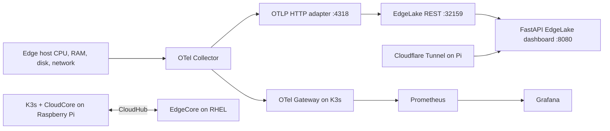

# KubeEdge + EdgeLake observability demo

A two-node edge observability demo with **K3s control plane**, **KubeEdge EdgeCore worker**, **EdgeLake**, **OpenTelemetry**, a Python **OTLP-to-EdgeLake adapter**, an EdgeLake-native web dashboard, and optional **Prometheus/Grafana**.

> **Reproducibility status:** The adapter and dashboard source are included from the working lab. Kubernetes manifests are **sanitized reference exports**; this is **not yet a one-command clean install**. You must supply KubeEdge CloudCore/EdgeCore join credentials and certificates, EdgeLake bootstrap/table policies, registry access and any missing Helm charts. Do not apply all exported manifests blindly.

## Architecture



## Validated environment

| Component | Lab setup |
|---|---|
| Control plane | Raspberry Pi, K3s `v1.31.6+k3s1`, IP `10.0.0.7` |
| Edge node | RHEL 9.3, KubeEdge EdgeCore v1.19.0, IP `10.0.0.20` |
| EdgeLake | `quay.io/jpaulraj_se_jboss/edgelake:1.5.2606` |
| EdgeLake dashboard | `quay.io/jpaulraj_se_jboss/edgelake-dashboard:0.4` |
| Edge collector | `otelcol-contrib` v0.102.1 |
| Dashboard URL | `https://edgelake.jplabusa.com` (example only) |

## Repository layout

```text
src/otel-edgelake-adapter/    Python OTLP receiver, EdgeLake writer, Containerfile
src/edgelake-dashboard/      FastAPI API, static dashboard, Chart.js, Containerfile
manifests/edgelake/          sanitized deployment/service/configmap examples
manifests/kubeedge/          sanitized CloudCore reference manifests
manifests/observability/     sanitized Grafana/Prometheus/OTel references
```

## 1. K3s control plane

On the control plane:

```bash
curl -sfL https://get.k3s.io | sh -
sudo kubectl get nodes -o wide
```

Pin a tested K3s version and architecture for repeatable installs. The working lab also used `egress-selector-mode: disabled` in `/etc/rancher/k3s/config.yaml` for its KubeEdge streaming topology. **Do not overwrite an existing K3s configuration.**

## 2. KubeEdge CloudCore and EdgeCore

Use the version-matched official KubeEdge `keadm` installation steps: https://kubeedge.io/docs/setup/install-with-keadm/ . On the control plane, initialize CloudCore advertising the control-plane reachable IP. Securely generate a join token. On the edge host, join EdgeCore to `<CONTROL_IP>:10000` with the matching KubeEdge version. Consult the exact `keadm` flags for the pinned release; commands differ by release/architecture.

The original lab used CloudHub at `10.0.0.7`, EdgeStream at `10.0.0.7:10004`, and CloudStream ports `10003/10004`. `kubectl exec` on edge pods required matching certificate trust; the working stream certificate was signed by the K3s CA. **Never overwrite the K3s server CA.**

```bash
kubectl get nodes -o wide
kubectl get pods -n kubeedge -o wide
# on the edge host:
sudo systemctl status edgecore --no-pager
```

## 3. EdgeLake on the worker

Review `manifests/edgelake/` and substitute node hostname, host data path, image pull credentials, and all IPs. The lab persisted data from `/var/lib/edgelake/data` to `/app/EdgeLake/data`. The EdgeLake service used ports `32158`, `32159` (REST) and `32160`.

The telemetry database/table was **`monitoring.otel_edge_metrics`**. It was created through an EdgeLake **blockchain table policy**, not conventional SQL DDL. The exported table policies are now provided as sanitized templates under `config/`; registering these policies in a fresh EdgeLake installation still requires verification of the supported blockchain commands.

Schema: `row_id`, `insert_timestamp`, `timestamp`, `edge_node`, `cpu_percent`, `memory_used_bytes`, `memory_free_bytes`, `memory_total_bytes`, `memory_percent`, `disk_used_bytes`, `disk_free_bytes`, `disk_total_bytes`, `disk_percent`, `network_recv_bytes`, `network_sent_bytes`, `load_1`, `load_5`, `load_15`.

```bash
curl -s -X GET http://10.0.0.20:32159 \
  -H 'command: sql monitoring select count(*) from otel_edge_metrics'
```

## 4. OTLP-to-EdgeLake adapter (included source)

On the edge host, after the EdgeLake table exists:

```bash
podman build -t otel-edgelake-adapter:demo src/otel-edgelake-adapter
podman run -d --name otel-edgelake-adapter --network host \
  --restart=unless-stopped \
  -e EDGELAKE_URL=http://127.0.0.1:32159 \
  -e EDGELAKE_DB=monitoring -e EDGELAKE_TABLE=otel_edge_metrics \
  otel-edgelake-adapter:demo
curl -fsS http://127.0.0.1:4318/health
```

Install an architecture-compatible OpenTelemetry Collector Contrib on the edge and configure the `hostmetrics` receiver (CPU, memory, disk, filesystem, network, load) with **both** OTLP exporters: local `http://127.0.0.1:4318` for EdgeLake and central `<CONTROL_IP>:30317` for Grafana/Prometheus.

## 5. EdgeLake dashboard (included source)

Build and run locally on the edge host:

```bash
podman build -t edgelake-dashboard:demo src/edgelake-dashboard
podman run -d --name edgelake-dashboard --network host \
  -e EDGELAKE_URL=http://127.0.0.1:32159 \
  edgelake-dashboard:demo
curl -fsS http://127.0.0.1:8080/health
curl -fsS http://127.0.0.1:8080/api/latest
```

To manage it through KubeEdge, push the image to a registry accessible from the edge containerd runtime and update `manifests/edgelake/deployment-edgelake-dashboard.yaml`. The working deployment used `hostNetwork: true` and `dnsPolicy: ClusterFirstWithHostNet`, because direct edge pod routing/NodePort did not work from the Pi. **Stop the Podman dashboard before launching the KubeEdge dashboard on port 8080.**

## 6. Central metrics / Grafana (optional)

The original pipeline was Edge OTel -> Pi OTel Gateway (`30317` gRPC) -> Prometheus (`30091`) -> Grafana (`30090`). Sanitized live resource examples are in `manifests/observability/`; prefer fresh Helm installs and your own credentials rather than blindly applying exports. The Grafana dashboard JSON was not part of the uploaded archives.

## 7. Cloudflare (optional)

The working Pi used a **remotely managed** Cloudflare Tunnel with `--token-file /etc/cloudflared/token`. Configure a public hostname in Cloudflare Zero Trust to use `http://<EDGE_IP>:8080` as origin. Do not commit the token, open the Kubernetes API publicly, or expose EdgeLake REST on the Internet.

## 8. Verification

```bash
kubectl get nodes -o wide
kubectl get pods -n edgelake -o wide
curl -fsS http://<EDGE_IP>:8080/health
curl -fsS http://<EDGE_IP>:8080/api/latest
curl -s -X GET http://<EDGE_IP>:32159 \
  -H 'command: sql monitoring select count(*) from otel_edge_metrics'
```

## Still needed for turnkey installation

1. Verify EdgeLake blockchain policy registration and database creation on a clean instance (table-policy templates and a safe inspection script are included).
2. Tested scripted KubeEdge certificate setup and token-safe CloudCore/EdgeCore join.
3. Version-pinned installation for Raspberry Pi ARMv7 and RHEL x86_64.
4. Fresh-install tests, complete Helm values and Grafana dashboard export.
5. Review all reference manifests and configuration for environment-specific settings before public release.

## Upstream

- https://k3s.io/
- https://kubeedge.io/
- https://opentelemetry.io/
- https://github.com/EdgeLake/EdgeLake

## Reusable bootstrap policies (new)

`config/table-policies.template.json` contains **only the DDL and table names** recovered from the real EdgeLake blockchain table policies. The original policy IDs, timestamps, ledger labels, company details, public IPs, geolocation and cluster/operator IDs are **not** included in the reusable configuration. `config/operator-policy.example.json` and `config/cluster-policy.example.json` are placeholders, not working registered policies.

Run the safe inspection first:

```bash
python3 scripts/bootstrap-edgelake.py --url http://127.0.0.1:32159
```

It compares the template against registered table policies and **does not modify EdgeLake**. Registering a policy requires the exact command supported by your EdgeLake version; this has **not been validated from the supplied files**. To prevent accidental damage, the script only runs a registration command if you explicitly supply `--apply --register-command '...'` after verifying that syntax. Do **not** blindly run SQL DDL from the policy as a replacement for blockchain registration.

## Prepare manifests for your environment

```bash
python3 scripts/render-manifests.py --edge-ip 192.168.1.20 --edge-node my-edge
# Review generated/*.yaml before using kubectl apply
```

This generates **editable** copies only. The included reference exports may still need edits for host paths, image registry credentials, runtime configuration, permissions, and CloudCore certificate setup.

## Validate source and deployment

```bash
bash scripts/package-source.sh
EDGE_IP=192.168.1.20 bash scripts/verify-installation.sh
```

The source build and smoke checks have not been exercised against a new clean K3s/KubeEdge environment. A clean-room installation is required before claiming turnkey support.

## GitHub publishing checklist

1. Inspect `git diff --cached` and run secret scanning before pushing.
2. Supply your own domain/IPs, Cloudflare token, Quay pull credentials, and EdgeLake operator/cluster identity.
3. Validate `bootstrap-edgelake.py` policy registration with the EdgeLake release you deploy.
4. Test KubeEdge join, streaming certificates, EdgeLake persistence, adapter ingestion and dashboard access on fresh nodes.
5. Choose a repository license and verify licenses for included upstream/vendor assets (notably the vendored Chart.js).
