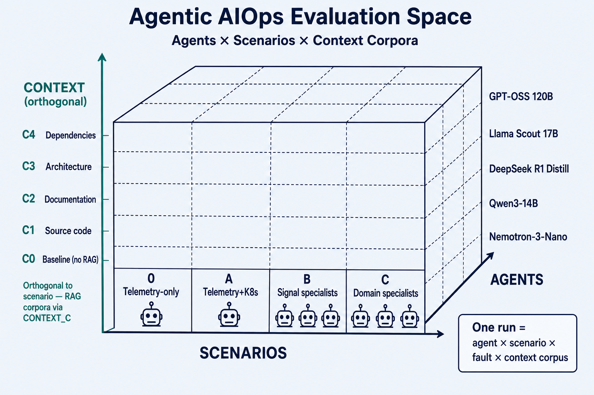

# Agentic AIOps Evaluation Harness

Framework for comparing LLM agents on autonomous fault detection and remediation. Measures MTTD (Mean Time To Detect) and MTTR (Mean Time To Repair) across models, scenarios, fault types, and context corpora.

## Architecture

- **Telemetry**: OTEL Demo → Collector → ClickHouse in `agentic-aiops` (logs, traces, metrics)
- **Fault injection**: Kubernetes API (scale_zero, kill_pod, memory_limit, network_partition, etc.)
- **Agents (default matrix)**: Qwen3-14B, Qwen3.8-27B, Qwen3.6-27B, DeepSeek R1 Distill 14B, Granite 3.2 8B Instruct, GLM-5.3 Flash  
- **Shared prompts**: all agents use `code/agents/prompts.py` (same task framing; profile overlays still come from `tool_profiles.py`)  
  (Nemotron/Kimi/Llama31/Scout/GPT-OSS dropped — see [RUN_NOTES_07Oct26.md](docs/RUN_NOTES_07Oct26.md), [RUN_NOTES_10Aug26.md](docs/RUN_NOTES_10Aug26.md))
- **Experiment tracking**: MLflow (local)
- **No frameworks**: No LangChain, no AutoGen — each agent is a single Python file with a tool-calling loop

Each harness run picks one cell in the evaluation space: **agent × scenario × context** (plus a fault). Context corpora (C0–C4) are orthogonal to scenario topology.



## Quick Start

```bash
# 1. Set up credentials
cp config/.env.example config/.env
# Edit config/.env with your API keys and endpoints

# 2. Deploy ClickHouse, then patch the OTEL Collector ConfigMap to add a
#    ClickHouse exporter on the traces, metrics, and logs pipelines
#    (cross-namespace to agentic-aiops; also drops the broken Prometheus metrics exporter)
oc apply -f manifests/clickhouse.yaml
python3 scripts/patch-otel-collector-clickhouse.py
oc port-forward -n agentic-aiops svc/clickhouse 38123:8123 &

# 3. Start local MLflow (required — do not use OpenShift mlflow)
#    Or: ./scripts/ensure_local_mlflow.sh
/usr/bin/python3.13 -m mlflow server \
  --backend-store-uri sqlite:///mlflow_local.db \
  --default-artifact-root ./mlartifacts \
  --serve-artifacts --host 0.0.0.0 --port 5050 --workers 1 &

# 4. Run the harness
./scripts/run_harness.sh --scenario a --flag scale_zero --variant cart

# 5. View results
open http://localhost:5050
```

## Fault Types

All faults injected via the Kubernetes API (`code/harness/run_harness.py`):

| `--flag` | What it does | Detection signal | Recovery |
|---|---|---|---|
| `scale_zero` | Scales deployment to 0 replicas | Missing pods, connection errors | Scale to 1 |
| `kill_pod` | Deletes all pods for target | Brief errors, restart events | Self-healing |
| `memory_limit` | Sets 10Mi memory limit (OOMKill) | CrashLoopBackOff, OOMKilled events | Remove limit |
| `network_partition` | Blocks ingress via NetworkPolicy | Connection timeouts, 5xx errors | Delete policy |
| `readiness_probe_fail` | Sets always-failing readiness probe | Pod not ready, removed from endpoints | Remove probe |
| `config_corruption` | Injects invalid DATABASE_HOST env var | Connection errors to bad host | Remove env var |
| `dependency_removal` | Scales a backing service to 0 | Upstream cascade errors | Scale back to 1 |
| `replica_overload` | Scales target to 0 + load-generator to 3 | Service down + high traffic | Restore both |
| `node_taint` | Taints node with NoExecute | All pods evicted, Pending | Remove taint |
| `pvc_full` | Fills 500MB in pod /tmp | Write errors | rm fill file |

Usage: `./scripts/run_harness.sh --flag <fault_type> --variant <deployment_name>`

## Scenarios

Defined in `config/scenarios.yaml`:

| Scenario | Mode | Tools Available | Purpose |
|---|---|---|---|
| **0** | Single agent | Telemetry only (search_logs, search_traces, search_metrics) | Baseline — can telemetry alone detect? |
| **a** | Single agent | Telemetry + K8s (+ get_pod_status, get_events, restart_deployment, scale_deployment, delete_pod) | Full autonomous — detect + diagnose + fix |
| **b** | Multi-agent | logs_only / traces_only / metrics_only specialists | Does signal specialization help? |
| **c** | Multi-agent | hardware / platform / application domain specialists | Does domain specialization help? |

Usage: `./scripts/run_harness.sh --scenario a` or `--all-scenarios`

## Context corpora (orthogonal to scenarios)

Controlled by `CONTEXT_C` / `config/context_c_levels.yaml`. When C1–C4 are enabled, agents must call the matching RAG tool(s) before other tools unlock (`code/tools/rag_policy.py` + `code/agents/rag_force.py`). Empty corpora abort the run **before** fault injection (`EmptyCorpusError`) — no soft-fallback to telemetry-only.

| Corpus | Tool | Content |
|--------|------|---------|
| **C0** | (none) | Live telemetry / scenario tools only |
| **C1** | `rag_search_source` | App source (`src/**`) |
| **C2** | `rag_search_docs` | Docs / README / changelog |
| **C3** | `rag_search_architecture` | System overview (README, compose topology, …) |
| **C4** | `rag_search_dependencies` | Compose files, Dockerfiles, collector configs |

## Agents

| Agent | Model | Tool calling | Env vars |
|-------|-------|-------------|----------|
| `qwen3_agent/` | Qwen3-14B | Native + streaming | `QWEN3_API_KEY`, `QWEN3_API_BASE` |
| `qwen38_27b_agent/` | Qwen3.8 27B | Native | `QWEN38_API_KEY`, `QWEN38_API_BASE`, `QWEN38_MODEL` |
| `qwen36_27b_agent/` | Qwen3.6 27B | Native | `QWEN36_API_KEY`, `QWEN36_API_BASE`, `QWEN36_MODEL` |
| `deepseek_agent/` | DeepSeek R1 Distill 14B | Prompt-based | `DEEPSEEK_API_KEY`, `DEEPSEEK_API_BASE` |
| `granite_agent/` | Granite 3.2 8B Instruct | Native (+ content fallback) | `GRANITE_API_KEY`, `GRANITE_API_BASE`, `GRANITE_MODEL` |
| `glm_53_flash_agent/` | GLM-5.3 Flash | Native | `GLM_API_KEY`, `GLM_API_BASE`, `GLM_MODEL` |
| `nemotron_agent/` | Nemotron Cascade 2 30B | Native + reasoning | *Optional — dropped (prelude timeout/503 since Oct 2026)* |
| `kimi_k2_agent/` | Kimi K2-7 | Native | *Optional — dropped from default matrix (Oct 2026)* |
| `llama31_70b_agent/` | Llama 3.1 70B (CPU) | Native (+ content fallback) | *Optional — dropped (0% detect Oct 2026)* |
| `llama_scout_agent/` | Llama Scout 17B | Native | *Optional — dropped from default matrix (Aug 2026)* |
| `gpt_oss_agent/` | GPT-OSS 120B | Native | *Optional — dropped from default matrix (Aug 2026)* |

All credentials in `config/.env` (gitignored). `run_harness.sh` sources it automatically.

## Metrics

| Metric | Definition |
|--------|-----------|
| **MTTD** | `fault_injection → detection` (when agent decides there's a fault) |
| **MTTR** | `fault_injection → system fixed` (when agent's write tool succeeds) |
| **Remediation Time** | `detection → system fixed` (MTTR - MTTD) |
| **MTTR = None** | Agent detected but did not execute a fix |

AI performance metrics (per run): TTFT, tokens/sec, total tokens, tool calls, LLM rounds.

## Matrix campaigns

```bash
# All agents × 8 faults × scenarios 0/a/b/c  (~10–12 hours; ~128+ runs with 4 agents)
bash scripts/run_full_matrix.sh

# Scenario A only × agents × 3 faults × C1–C4  (context-engineering sweep)
bash scripts/run_c_matrix_scenario_a_c1-c4.sh
# Optional C0 baseline: INCLUDE_C0=1 bash scripts/run_c_matrix_scenario_a_c1-c4.sh

# Option 2 — all CONTEXT_C subsets (16) × agents × 3 faults = 240 runs (~14h)
bash scripts/run_c_matrix_scenario_a_c_permutations.sh

# Full cross-product: agents × scenarios 0/a/b/c × faults × C0–C4  (very long)
bash scripts/run_full_c_matrix.sh
```

Matrix wrappers call `scripts/preflight_agent_apis.py` first and **abort** if any default-lineup LLM endpoint fails `chat/completions` (HTML error pages, connection errors, missing creds). That prevents the Aug 2026 failure mode where Nemotron HTML / Llama connection errors were recorded as soft `detected=false`.

`scripts/run_c_matrix.sh` is a compatibility shim that forwards to `run_c_matrix_scenario_a_c1-c4.sh`.

## Project Structure

```
code/
├── harness/           # Orchestration (run_harness.py, scenarios.py)
├── agents/            # One dir per model (qwen3, deepseek, granite, glm_53_flash, …)
│   ├── skills/        # Shared detect/diagnose/remediate/verify skill prompts
│   └── ai_metrics.py  # Shared TTFT/token/latency tracking
└── tools/             # Shared tools (agent_tools.py, tool_profiles.py, context_engineering)
config/                # .env, harness.yaml, scenarios.yaml, context_c_levels.yaml
scripts/               # run_harness.sh, run_full_matrix.sh, run_c_matrix_scenario_a_c1-c4.sh, …
manifests/             # OpenShift deployments (mlflow, clickhouse, vllm)
evalhub/               # TrustyAI EvalHub provider + manifests
docs/                  # Architecture, credentials, results
data/                  # Event ledger (runtime)
out/                   # Run output JSONs (gitignored)
```

## Docs

- [EVALUATION_RESULTS_09oct26.md](docs/EVALUATION_RESULTS_09oct26.md) — Oct execute-gate matrix: 7 agents × 16 contexts × 3 faults (336/336)
- [COMPARE_09oct26_vs_23sep26.md](docs/COMPARE_09oct26_vs_23sep26.md) — Oct vs Sep baseline compare
- [RUN_NOTES_07Oct26.md](docs/RUN_NOTES_07Oct26.md) — Oct 7–9 execute-gate matrix + post-run cleanup (llama dropped, generic prompts)
- [EVALUATION_RESULTS_27sep26.md](docs/EVALUATION_RESULTS_27sep26.md) — Option 2 re-run: skills + no-CHANGELOG (335/336, MLflow-audited)
- [COMPARE_27sep26_vs_23sep26.md](docs/COMPARE_27sep26_vs_23sep26.md) — Sep 27 vs Sep 23 compare
- [RUN_NOTES_25Sep26.md](docs/RUN_NOTES_25Sep26.md) — Skills + no-CHANGELOG Option 2 re-run (timeouts raised)
- [EVALUATION_RESULTS_23sep26.md](docs/EVALUATION_RESULTS_23sep26.md) — Option 2 baseline: 7 agents × 16 CONTEXT_C × 3 faults (336 runs)
- [RUN_NOTES_14Sep26.md](docs/RUN_NOTES_14Sep26.md) — Next matrix: iteration budget 20, health gate, MLflow metrics, C0 vs context investigation
- [Learnings_across_runs_report.md](docs/Learnings_across_runs_report.md) — Cross-run: why agents don’t execute, context value, chunking, next tests
- [EVALUATION_RESULTS_12Aug26.md](docs/EVALUATION_RESULTS_12Aug26.md) — Option 2 expanded MaaS lineup: 8 agents, 384 runs, MLflow-validated
- [RUN_NOTES_11Aug26.md](docs/RUN_NOTES_11Aug26.md) — Aug 11 expanded MaaS lineup (Nemotron swap, Qwen3.8/3.6/Kimi added)
- [EVALUATION_RESULTS_11Aug26.md](docs/EVALUATION_RESULTS_11Aug26.md) — Option 2 re-run: Granite + Llama31, drop Scout/GPT-OSS (240 runs) + MLflow audit
- [RUN_NOTES_10Aug26.md](docs/RUN_NOTES_10Aug26.md) — Aug 2026 lineup change + smoke notes
- [EVALUATION_RESULTS_26July26.md](docs/EVALUATION_RESULTS_26July26.md) — Option 2: scenario A × all CONTEXT_C subsets (240 runs) + MLflow audit
- [EVALUATION_RESULTS_25July26.md](docs/EVALUATION_RESULTS_25July26.md) — Option 1 re-run: scenario A × C0–C4, forced RAG, fixed corpora (75 runs)
- [EVALUATION_RESULTS_07July26.md](docs/EVALUATION_RESULTS_07July26.md) — Scenario A × C1–C4 (optional RAG, pre-force)
- [EVALUATION_RESULTS_23June26.md](docs/EVALUATION_RESULTS_23June26.md) — Full scenario matrix results (128 runs)
- [CONTEXT_ENGINEERING_EVAL_REPORT.md](docs/CONTEXT_ENGINEERING_EVAL_REPORT.md) — Auto-generated context corpus report
- [ARCHITECTURE.md](docs/ARCHITECTURE.md) — Current system architecture
- [LLM_CREDENTIALS.md](docs/LLM_CREDENTIALS.md) — API key setup
- [OPENSHIFT_OTEL_DEPLOYMENT.md](docs/OPENSHIFT_OTEL_DEPLOYMENT.md) — OpenShift deployment

## Backlog

- Multi-model pipeline — fast detection → deep RCA → constrained remediation with different models per stage
- ~~Agent self-verification~~ — implemented as execute gate (`AGENT_EXECUTE_GATE=1`); blocks final JSON until rem write
- Reinforcement loop — use results to improve prompts automatically
- Local ClickHouse — run telemetry DB locally so harness works without OpenShift
