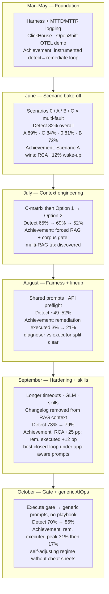
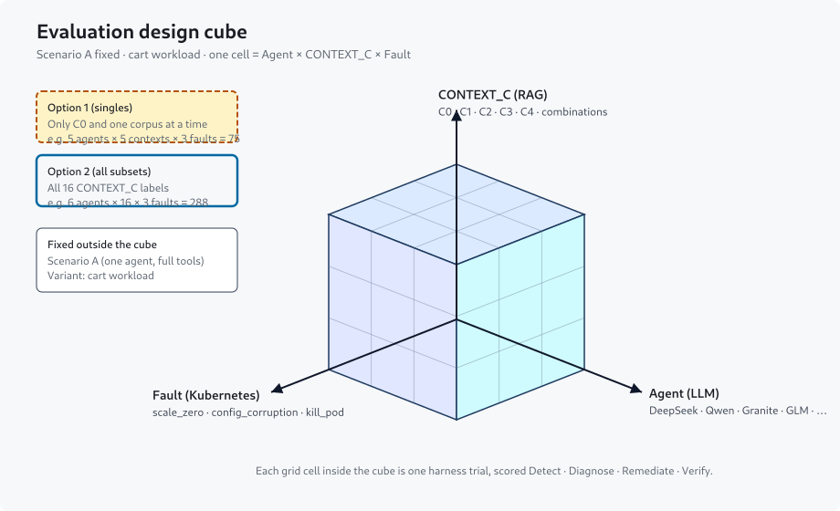

# Longitudinal Report — March → October 2026

**Generated:** 2026-10-12 (revised 2026-10-14, 2026-10-19)  
**Scope:** Matrix harness JSON + local MLflow (`agentic_aiops_mttd_mttr` in `mlflow_local.db`) + dated evaluation / run-note docs under `docs/`.  
**Purpose:** Single narrative of **what we changed** and **how detection, RCA, remediation execution, and recovery moved** from the first fair scenario matrix through the latest Option 2 matrix.

> **Comparability warning.** Overall % across eras are **not** pure model bake-offs. Design size (faults, contexts, agents), prompts, RAG, timeouts, and scoring evolved. Prefer **same-design Δ tables** (linked below) for causal claims; use era-level % for trajectory only.

---

## Journey diagram (March → October 2026)

Harness work began in March; **fair matrix evaluation starts in June**. Each node is a milestone with its key achievement (detection rates are batch averages).

| Step | Key achievement |
|------|-----------------|
| **Mar–May** | Instrumented agentic MTTD/MTTR harness on live cluster telemetry |
| **June** | Proved single-agent Scenario A beats 0 / B / C; exposed ~12% cart RCA |
| **July** | Made CONTEXT_C RAG measurable (forced retrieval + corpus gate + C0 control); found multi-corpus tax |
| **August** | Unified prompts + preflight; remediation executed jumped to 21% |
| **September** | Skills + changelog removed from context + longer timeouts: detect 79%, diagnose 59%, remediate 25% |
| **October** | Execute gate pushed remediate to 31%; then app-agnostic prompts hit detect 86% without playbooks |

---

## 1. Executive arc (one page)

### What this harness is (read first)

We inject a **known Kubernetes fault** into a demo app (usually the cart workload), then give an LLM agent a time window with tools (logs/metrics, pod status, scale/restart, optional document search). Each trial is one **cell**: one agent × one context setting × one fault. After the agent finishes, the harness scores four AIOps stages:

| Stage | Plain meaning | Scored when… |
|-------|---------------|--------------|
| **Detect** | Did the agent notice something is wrong? | `detected=true` |
| **Diagnose (RCA)** | Did it name the right failing workload / cause? | `rca_correct=true` |
| **Remediate** | Did it actually call a write tool (scale/restart/delete/patch)? | `remediation_executed=true` — suggestions alone do **not** count |
| **Verify** | Did the workload become healthy again afterward? | `recovery_verified=true` |

**Batch average** = successes ÷ all cells in that run (every cell counts once). It is **not** the average of per-agent percentages across months.

**Jargon used below**

| Term | Meaning |
|------|---------|
| **Scenario A** | One agent with telemetry + Kubernetes tools (the production-like topology we kept after June) |
| **CONTEXT_C / C0–C4** | Optional RAG corpora: none (C0), source, docs, architecture, dependencies — alone or combined |
| **Option 1** | **Idea:** keep Scenario A fixed; give the agent **at most one** RAG corpus per trial (C0 = none, or C1, or C2, or C3, or C4). Ask: does *any single* corpus help detect/diagnose vs no RAG? Typical size: 5 agents × 5 contexts × 3 faults = **75** cells. |
| **Option 2** | Same cube, but CONTEXT_C = **all 16** subsets (pairs/triples/all-four too). Larger matrix used Aug–Oct. |
| **Forced RAG** | Agent must call the enabled search tools before other tools unlock |
| **Execute gate** | Harness blocks “I’m done” JSON if the agent detected a fault but never called a rem write tool |

### Design cube — what we permute and compare

After June locked **Scenario A**, each fair matrix cell is one point in a **3D design cube** (Agent × CONTEXT_C × Fault). Every cell is scored Detect · Diagnose · Remediate · Verify.

**Option 1 idea (plain English):** freeze the agent topology (Scenario A, cart workload) and only vary **which single RAG folder** is available — none, source, docs, architecture, or dependencies. That isolates “does architecture help diagnose?” without also mixing pairs of corpora. **Option 2** later opens the full 16-label subset space and showed that forcing many corpora at once hurts detect.

**What we compare against what**

| Comparison | Slice of the cube | Question it answers |
|------------|-------------------|---------------------|
| **Agent vs agent** | Fix context + fault (or pool over them); vary model | Which LLM detects / diagnoses / remediates better under the same tools and RAG? |
| **CONTEXT_C vs CONTEXT_C** | Fix agent lineup + faults; vary corpus label | Does source, docs, architecture, deps, or a *combination* help? Is C0 (no RAG) enough? |
| **Fault vs fault** | Fix agents + contexts; vary injected fault | Which fault types are easier/harder (e.g. `scale_zero` vs `config_corruption`)? |
| **Option 1 vs Option 2** | Singles C0–C4 vs all 16 subsets | Does *combining* corpora help, or does forced multi-RAG burn the window? |
| **June scenarios 0/A/B/C** | *Before* the cube — vary topology, not CONTEXT_C | Should we use one full-tool agent (A) or specialists? → **A wins**, then we freeze A. |
| **Batch vs batch (era)** | Same cube shape, different prompts/skills/gate/lineup | Did skills, changelog removal, execute gate, or generic prompts move the four stage rates? |

**CONTEXT_C labels in Option 2 (16 permutations)** — each is a face/edge/corner of the corpus subcube `{1,2,3,4}` plus the origin C0:

| Size | Labels (use `&` in prose; files may use hyphens) |
|------|--------------------------------------------------|
| 0 | **C0** (no RAG) |
| 1 | C1, C2, C3, C4 |
| 2 | C1&C2, C1&C3, C1&C4, C2&C3, C2&C4, C3&C4 |
| 3 | C1&C2&C3, C1&C2&C4, C1&C3&C4, C2&C3&C4 |
| 4 | C1&C2&C3&C4 |

Under **forced RAG**, every corpus in the label must be searched before telemetry/Kubernetes tools unlock — that is why larger labels cost more early rounds.

### Results by era (all four stages)

Rates are **batch averages**. “—” means not measured or not comparable in that batch. Strongest/weakest refer to **detection** leaders among agents in that run.

| When | Experiment in plain English | Detect | Diagnose (RCA) | Remediate | Verify | Best / worst detector | What changed vs prior |
|------|-----------------------------|-------:|---------------:|----------:|-------:|-----------------------|------------------------|
| **Jun 22–23** | Compare four agent topologies (0=telemetry only, A=full tools, B=signal specialists, C=domain specialists) on many fault types | **82%** (A **89%**, C **84%**, 0 **81%**, B **72%**) | ~**12%** (cart named correctly) | ~**12%** | — | Best: Llama Scout · Worst: Qwen3 | First fair matrix; **Scenario A wins** |
| **Jul 6–7** | Keep Scenario A; add optional doc/code search (C1–C4), one corpus at a time | **65%** | **27%** | 10% | 0% | Best: Scout / Nemotron 100% · Worst: Qwen3 0% (empty replies) | Context study; agents often **never called** RAG |
| **Jul 24–25** | Option 1 with fixed indexes; force agents to use RAG | **69%** | **55%** | 25% | 12% | Best: Nemotron 93% · Worst: Scout / GPT-OSS 40% | First fair evidence architecture RAG helps diagnose |
| **Jul 25–26** | Option 2: try **all combinations** of corpora (16 labels) | **52%** | 34% | 10% | 10% | Best: DeepSeek 94% · Worst: GPT-OSS 31% | **More corpora ≠ better** — forced multi-search burns the time window |
| **Aug 10–11** | Option 2 with Granite + Llama 3.1; drop Scout/GPT-OSS | **49%** | 38% | **3%** | 3% | Best: Granite / DeepSeek · Worst: Nemotron / Llama31 **0%** (API down) | Lineup change; API failures polluted the average |
| **Aug 11–12** | Option 2 with shared prompts for every agent + more MaaS models | **52%** | 44% | **21%** | 19% | Best: Granite 100% · Worst: Llama31 0% | **Remediate jumps** (Qwen36, cascade); diagnoser/executor split clear |
| **Sep 22–23** | Option 2 hardened: longer timeouts, more tool rounds, GLM added | **73%** | 34% | 13% | 12% | Best: GLM / Qwen3 100% · Worst: Llama31 0%; Qwen36 33% (timeouts) | Detect up; remediate still scarce |
| **Sep 25–27** | Same matrix + shared AIOps skills; **changelog removed from docs context**; longer timeouts | **79%** | **59%** | **25%** | **22%** | Best: DeepSeek / Granite 100% · Worst: Llama31 2% | Largest same-design lift in diagnose + remediate |
| **Oct 7–9** | Same matrix + **execute gate** (must try a write tool after detect) | **70%** | 57% | **31%** | **26%** | Best: DeepSeek / GLM 100% · Worst: Llama31 0%; Qwen38 33% | Remediate peaks; detect dips (gate + qwen-slot swap — §3.6) |
| **Oct 10–12** | Same idea but **generic prompts**, **no app playbook**, Llama dropped (6 agents) | **86%** | 61% | **17%** | 17% | Best: DeepSeek / Qwen3 100% · Worst: Qwen38 50% | Detect high without cheat sheets; remediate falls vs Sep peak |

**Closed-loop arc (one sentence):** detect is often high, but **diagnose and remediate lag** until Sep skills (diagnose **59%**, remediate **25%**); the Oct execute gate pushes remediate to **31%** at some cost to detect; dropping playbooks (Oct 10–12) keeps detect **86%** but remediate falls to **17%**.

**Persistent finding:** strong **diagnosers** (DeepSeek, Granite) rarely call remediation write tools; **executors** (GLM, Qwen36/38 when healthy) close more cells. Soft “fix it” wording alone does not turn diagnosers into actuators.

---

## 2. Performance trajectory

**Detect / RCA / Remediation executed / Recovery** columns are **batch averages** (overall successes ÷ trials in that batch), unless noted. Designs differ (faults, contexts, agents, prompts). Prefer same-design delta rows for causal claims; use the full table for trajectory.

### 2.1 Full timeline (June → October)

| Batch | Design (approx.) | Detect (batch avg) | Strongest detect | Weakest detect | RCA | Remediation executed | Recovery | Notes |
|-------|------------------|-------------------:|------------------|----------------|----:|---------------------:|---------:|-------|
| Jun 22–23 full scenario | 4 agents × ≤8 faults × scenarios 0/A/B/C ≈ 132 | **82%** (108/132) | Llama Scout | Qwen3 | ~**12%** cart (deep dive) | ~**12%** | — | By scenario detect: A **89%**, C **84%**, 0 **81%**, B **72%**; readiness 0% |
| Jul 6–7 C-matrix | 4 agents × 3 faults × C1–C4 = 48 | **65%** | Llama Scout / Nemotron | Qwen3 (0/12) | **27%** | 10% | 0% | Scenario A; RAG mostly unused |
| Jul 24–25 Option 1 | 5 agents × C0–C4 × 3 faults = 75 | **69%** | Nemotron (**93%**) | Scout / GPT-OSS (**40%**) | **55%** | 25% | 12% | Fixed corpora; forced RAG on |
| Jul 25–26 Option 2 | 5 agents × 16 contexts × 3 faults = 240 | **52%** | DeepSeek (**94%**) | GPT-OSS (**31%**) | 34% | 10% | 10% | Forced multi-RAG tax |
| Aug 10–11 Option 2 | 5 agents × 16 contexts × 3 faults = 240 | 49% | Granite / DeepSeek | Nano / Llama31 (**0%** API) | 38% | **3%** | 3% | API failures polluted aggregates |
| Aug 11–12 Option 2 | 8 agents × 16 contexts × 3 faults = 384 | 52% | Granite (**100%**) | Llama31 (**0%**) | 44% | **21%** | 19% | Shared prompts; Qwen36 / cascade remediation |
| Sep 22–23 Option 2 | 7 agents × 16 contexts × 3 faults = 336 | **73%** | GLM / Qwen3 (**100%**) | Llama31 (**0%**); Qwen36 **33%** | 34% | 13% | 12% | Longer iterations/timeouts; GLM added |
| Sep 25–27 Option 2 | same 7 agents / 336 (335 scored) | **79%** | DeepSeek / Granite (**100%**) | Llama31 (**2%**) | **59%** | **25%** | **22%** | Skills + changelog removed from docs context + 900s/1200s |
| Oct 7–9 Option 2 | same 7 agents / 336 | 70% | DeepSeek / GLM (**100%**) | Llama31 (**0%**); Qwen38 **33%** | 57% | **31%** | **26%** | Execute gate; qwen slot swapped to qwen38-27b (detect weak) |
| Oct 10–12 Option 2 | **6** agents × 16 contexts × 3 faults = 288 | **86%** | DeepSeek / Qwen3 (**100%**) | Qwen38 (**50%**) | 61% | 17% | 17% | Generic prompts; no playbook; no Llama |

MLflow calendar rollups (all runs with a `detected` metric that month — also batch-style averages over a calendar window, not a designed matrix): **June ~77%** (298/386), **July ~54%** (245/456). July’s month-level figure is pulled down by Option 2’s **52%** (and discarded infra-broken runs not shown in the fair timeline above).

### 2.2 Why detection (and related metrics) moved between rows

| Transition | Detect move | Why (mechanism, not vibes) |
|------------|-------------|----------------------------|
| Jun overall → by scenario | 82% overall; A **89%**, C **84%**, 0 **81%**, B **72%** | **Scenario A** (one agent, telemetry + Kubernetes) is best. **Scenario C** (domain specialists) is close but pays multi-agent coordination cost. **Scenario 0** (telemetry only, no Kubernetes tools) still detects most faults from logs/traces. **Scenario B** (signal specialists: logs/traces/metrics split) is worst — no single signal view is enough. |
| Jun Scenario A (~89%) vs Scenario 0/C | A ahead of 0 by ~8 percentage points; ahead of C by ~5 | Full tool access on one agent beats telemetry-only and beats splitting by domain. |
| Jun Scenario A (~89%) → Jul 6–7 (65%) | **−24** percentage points vs Scenario A | Same scenario A topology, but (1) fault set narrowed/changed scoring toward injected-cart RCA, (2) **context corpora** added without forced RAG — agents often never called RAG, (3) Qwen3 empty-response failures, (4) June’s 89% included easier multi-fault cells and did not use the later hybrid oracle the same way. Detect ≠ “saw any cluster noise”; July is stricter about the harness cell. |
| Jul 6–7 (65%) → Jul 24–25 Option 1 (69%) | **+4** percentage points | Non-empty C3/C4 indexes, corpus emptiness gate, and **forced RAG** so retrieval actually runs. C1 leads detect (**80%**); C0 still strong on detect (**73%**) but weaker on RCA. |
| Jul Option 1 (69%) → Jul Option 2 (52%) | **−17** percentage points | **Forced multi-corpus RAG tax:** every enabled `rag_search_*` must run before other tools unlock. Detect falls with corpus count (C0 **87%** → all-four **27%**). Weak models and Nemotron burn the window on RAG rounds and never finish a clean detect. |
| Jul Option 2 (52%) → Aug 11 (49%) / Aug 12 (52%) | Flat ~50% | Lineup swaps (drop Scout/GPT-OSS; add Granite/Llama31; then cascade + Qwen36/38/Kimi). Batch-average detect stays mid-range because **API-dead agents** (nano HTML, Llama31 connection) and weak newcomers dilute the overall rate even as DeepSeek/Granite detect well. Aug 12’s win is mostly **remediation executed 3%→21%**, not detect. |
| Aug (~50%) → Sep 22–23 (73%) | **+21–24** percentage points | Longer tool iteration budget (**8→20**), longer timeouts (agent **600s**, detection **720s**), preflight/health gates, **GLM** as a reliable detector, and omission of flaky Nemotron/Kimi. More cells complete a detect declaration inside the window. |
| Sep 22–23 (73%) → Sep 25–27 (79%) | **+6** percentage points | Shared **skills**, changelog removed from the docs RAG context (C2), timeouts **900s/1200s** (Qwen36 errors **32→8**/48). Skills mainly lift **RCA and remediation executed**; detect rises partly from fewer timeouts and clearer detect→diagnose procedure text. |
| Sep 25–27 (79%) → Oct 7–9 (70%) | **−9** percentage points | **Not** “models get nervous.” Mixed causes: execute-gate **extra rounds** (Granite MTTD ~40s→~174s), a few Granite final `detected=false` after blocked finishes, Qwen3 **`agent_error`** misses, and a large non-detect share from the **swapped qwen slot** (new `qwen38-27b` path: **33%** detect, **0** gate hits). See §3.6. |
| Oct 7–9 (70%) → Oct 10–12 (86%) | **+16** percentage points | Dropping Llama (**0%** detect dead weight), stronger DeepSeek/Granite/Qwen3 detect under generic prompts, and a 6-agent denominator. Remediation executed **falls** (playbook gone) while detect rises — different axes. |

### 2.3 Same-design Option 2 deltas (Sep → Oct)

| Transition | Detect | RCA | Remediation executed | Recovery | Dominant change |
|------------|-------:|----:|---------------------:|---------:|-----------------|
| Sep 22–23 → Sep 25–27 | +6 percentage points | **+25** percentage points | **+12** percentage points | +10 percentage points | Skills + C2 hygiene + timeouts (confounded) |
| Sep 25–27 → Oct 7–9 | **−9** percentage points | −2 percentage points | **+6** percentage points | +4 percentage points | Execute gate **plus** qwen-slot swap / detect drop (see §3.6) |
| Sep 25–27 → Oct 10–12* | +7 percentage points† | +2 percentage points† | **−8** percentage points† | −5 percentage points† | Generic prompts / playbook removed / Llama dropped |

\*Different trial count and lineup — treat as regime shift, not A/B.  
†October aggregate vs Sep 25–27 headline table in [EVALUATION_RESULTS_12oct26.md](EVALUATION_RESULTS_12oct26.md).

---

## 3. Chronology of changes and results

### 3.1 Before the first matrix (context only)

Harness, MTTD/MTTR fields, ClickHouse, and OpenShift OTEL demo wiring were built in the months before June. **Evaluation evidence in this report starts with the June 22–23 scenario matrix** — earlier test-only runs are omitted.

Active tracker for matrix results: `mlflow_local.db`, experiment `agentic_aiops_mttd_mttr` (first sustained batch **2026-06-19** onward).

---

### 3.2 June 2026 — Scenario bake-off and RCA wake-up call

**Reports:** [EVALUATION_RESULTS_22June26.md](EVALUATION_RESULTS_22June26.md), [EVALUATION_RESULTS_23June26.md](EVALUATION_RESULTS_23June26.md)  
**MLflow:** first sustained logging from **19–22 Jun** (~310 runs on 22 Jun).

**Changes**

| Change | Detail |
|--------|--------|
| Scenario taxonomy | **0** telemetry-only; **A** telemetry+Kubernetes; **B** signal specialists; **C** domain specialists |
| Fault set | Up to **8** faults (incl. readiness, network, memory, …) |
| Agents | Nemotron-nano-3, DeepSeek, Qwen3, Llama Scout |
| Campaign JSON | `out/campaign*.json` from **19 Jun** |

**Results (23 Jun full matrix, 132 runs)**

Each row is one **batch-level rate** for that metric (successes ÷ trials), not a per-agent score. “Rate” is the measured outcome for the matrix (or the named scenario slice).

| Metric | Rate | What it counts |
|--------|-----:|----------------|
| Overall detect | **82%** (108/132) | All scenarios × agents × faults in the recovered result set |
| Scenario A detect | **89%** | Telemetry + Kubernetes tools; single agent (best topology) |
| Scenario C detect | **84%** | Domain specialists (hardware / platform / application); multi-agent |
| Scenario 0 detect | **81%** | Telemetry only (logs/traces/metrics/ClickHouse); no Kubernetes API |
| Scenario B detect | **72%** | Signal specialists (logs-only / traces-only / metrics-only); weakest |
| Autonomous fixes | **~12%** (15 runs) | Cells where a remediation write tool actually ran |
| Cart RCA (deep dive) | **~12%** | Stricter post-hoc check: correctly named `cart` as root cause |

**Why Scenario 0 and C matter (and were easy to under-mention).**  
Headlines often cite only A (best) and B (worst). **Scenario 0** shows telemetry alone is already strong (**81%**) — Kubernetes tools help, but are not required for most of these faults. **Scenario C** (**84%**) shows domain multi-agent is nearly as good as A, but still loses a few points to coordination overhead versus one agent with the full toolset. Later matrices (July onward) **fixed Scenario A** and stopped re-testing 0/B/C, which is why 0 and C disappear from Option 1/2 tables — not because they failed.

**Improvements**

- Proved **single agent + full tools (A)** beats specialist splits (B) and edges out domain specialists (C) and telemetry-only (0).
- Llama Scout = fast detector; Nemotron = rare executor.

**Degradations / lessons**

- Multi-agent B (and to a lesser extent C) hurt Qwen3 and overall detect vs A.
- **Fix-the-wrong-service** problem forced later **hybrid oracle / RCA scoring**.
- `readiness_probe_fail` **0%** detect (invisible fault) → later matrices dropped it from the default 3-fault set.

---

### 3.3 July 2026 — Context engineering (C-model)

**Reports:** [EVALUATION_RESULTS_07July26.md](EVALUATION_RESULTS_07July26.md), [EVALUATION_RESULTS_25July26.md](EVALUATION_RESULTS_25July26.md), [EVALUATION_RESULTS_26July26.md](EVALUATION_RESULTS_26July26.md), [CONTEXT_ENGINEERING_EVAL_REPORT.md](CONTEXT_ENGINEERING_EVAL_REPORT.md)

#### How CONTEXT_C RAG was made measurable

**In short:** In early July RAG was only *offered*; agents almost never called it, so context effects were not measurable. We made it measurable by **tagging runs by corpus**, **guaranteeing non-empty indexes**, **forcing** each required `rag_search_*` before other tools unlock, and keeping a **C0** (no RAG) control. Only then could we compare corpus permutations on the design cube’s CONTEXT_C axis.

June had **no document/code retrieval axis** — agents only saw live telemetry and Kubernetes tools. July introduced **CONTEXT_C**: optional RAG corpora on top of Scenario A, so we could ask “does retrieved app context help detect / diagnose / remediate?” Making that question **answerable** required several harness changes; without them, “we enabled RAG” and “RAG had no effect” were indistinguishable from “the model never searched.”

**1. Separate scenario from context (C-model design)**  
- **Scenario** = who investigates and which live tools they get (fixed to **A** in July so multi-agent noise from June’s 0/B/C does not confound RAG).  
- **CONTEXT_C** = which optional search tools are offered: **C0** none; **C1** `rag_search_source` (app `src/**`); **C2** `rag_search_docs`; **C3** `rag_search_architecture`; **C4** `rag_search_dependencies`.  
- Multi-select is explicit (`CONTEXT_C=1,4`), not cumulative. RAG is **tool-call only** — chunks are never auto-pasted into the system prompt.  
- MLflow tags each run with `context_c` so rates can be sliced by corpus.

**2. First attempt (6–7 Jul) — corpora present, effect not measurable**  
Agents *could* call `rag_search_*`, but calls were **optional**. In practice they almost never did (0 RAG tool uses in the by-agent table). Outcome rates therefore could not be attributed to context: diagnose rose mainly via Llama Scout’s behavior, not retrieved docs. Lesson: **offering a tool ≠ testing a tool.**

**3. Non-empty indexes before scoring**  
Architecture/dependency globs were wrong at first, so C3/C4 indexes had **zero chunks**. Fix: correct globs/filters in `rag_context.py` and verify chunk counts before kickoff (later: **C1=1784, C2=130, C3=129, C4=166**). Empty-index batches are omitted from the fair timeline.

**4. Corpus emptiness gate — fail loud, not silent zero**  
`ensure_context_corpora_ready` / harness path aborts with `agent_error=corpus_empty:…` **before** fault injection if a requested C1–C4 index is empty. Empty retrieval can no longer masquerade as “model failed to detect.”

**5. Forced RAG (`FORCE_RAG=1`) — make retrieval happen**  
Implemented in `code/tools/rag_policy.py` and wired into every agent loop:

- While any CONTEXT_C corpus is still unused, the harness stays in a **RAG phase**: other tools stay locked until each required `rag_search_*` has been called.  
- Round 0 forces the first pending corpus tool; later rounds force the next until the set is complete (or the harness executes a default query via `execute_forced_rag` if the model skips).  
- Default queries are seeded from the fault/variant (e.g. cart + scale/replicas) so the forced call is not an empty string.  
- On the Jul 24–25 Option 1 re-run, **forced RAG used = 60/60** on C1–C4 cells — context was actually exercised.

**6. Score and compare with a no-RAG control**  
Include **C0** (no corpora) in the same matrix so C1–C4 can be compared to live-tools-only. Log whether RAG tools ran. Then rank contexts on detect / diagnose / remediate (e.g. C3 best diagnose **67%**, C0 diagnose only **40%** on the fair Option 1 re-run).

**7. Option 2 (25–26 Jul) — stress combinations**  
All 16 non-empty subsets of {1,2,3,4} under the same forced policy. That made the **multi-RAG tax** measurable: detect falls as more corpora are forced (C0 **87%** → all-four **27%**), because each corpus burns an early tool round before telemetry/Kubernetes unlock.

**Net:** CONTEXT_C became measurable when we (a) tagged and sliced by corpus, (b) guaranteed non-empty indexes, (c) **forced** retrieval before other tools, and (d) kept a C0 baseline. Only then could “architecture RAG helps diagnose” and “forcing four corpora hurts detect” be treated as experiment results rather than anecdotes.

#### 7 Jul — first C1–C4 singles (scenario A, 48 runs)

| Metric | Rate |
|--------|------:|
| Detect | 65% |
| RCA | **27%** (vs ~12% June deep-dive) |
| Remediation executed | 10% |
| Recovery | 0% |

**Finding:** Diagnose rose mainly via Llama Scout; **agents rarely called RAG** — so context looked ineffective. Qwen3 empty-response failures. (Measurability incomplete — see above.)

#### Changes before 24–25 Jul Option 1

| Change | Why |
|--------|-----|
| Fix C3/C4 globs + architecture filter (`rag_context.py`) | Non-empty corpora |
| Corpus emptiness abort in harness | Fail fast instead of silent 0% |
| `FORCE_RAG=1` (`rag_policy.py`) | Force RAG tool use so context is actually tested |
| Agents | + GPT-OSS 120B; still Scout / Nemotron / DeepSeek / Qwen3 |

#### 24–25 Jul Option 1 (C0–C4 singles, 75 runs) — **first fair RAG measurement**

| Metric | Rate |
|--------|------:|
| Detect | **69%** |
| RCA | **55%** |
| Remediation executed | 25% |
| Recovery | 12% |
| Forced RAG used (C1–C4) | **60/60 (100%)** |
| `corpus_empty` aborts | **0/75** |

Context ranking (fair, non-empty):

| Context | Detect | RCA |
|---------|-------:|----:|
| C0 | 73% | 40% |
| C1 source | **80%** | 60% |
| C2 docs | 67% | 60% |
| C3 arch | 73% | **67%** |
| C4 deps | 53% | 47% |

**Improvements:** Architecture RAG helps diagnose; C0 detects but under-diagnoses; Nemotron **93%** detect / **73%** remediation executed on this small matrix. DeepSeek: strong RCA with RAG, **0** remediation executed.

#### 25–26 Jul Option 2 (all CONTEXT_C subsets, 240 runs) — **degradation vs Option 1**

| Metric | Rate |
|--------|------:|
| Detect | **52%** |
| RCA | 34% |
| Remediation executed | **10%** |
| Recovery | 10% |

**Forced multi-RAG tax:** detect fell with corpus count (C0 **87%** → all-four **27%**). Combining corpora is not free under “call every RAG tool before other tools.”

**Agent note:** DeepSeek **94%** detect+RCA; Scout/GPT-OSS ~30%; Nemotron dropped vs Option 1 singles.

---

### 3.4 August 2026 — Lineup, fairness, preflight

**Run notes:** [RUN_NOTES_10Aug26.md](RUN_NOTES_10Aug26.md), [RUN_NOTES_11Aug26.md](RUN_NOTES_11Aug26.md)  
**Report:** [EVALUATION_RESULTS_12Aug26.md](EVALUATION_RESULTS_12Aug26.md)  
*(Dated `EVALUATION_RESULTS_11Aug26.md` is referenced historically; numbers below come from Aug-12 report + later tables.)*

#### 10–11 Aug — Scout/GPT-OSS out; Granite + Llama31 in

| Change | Detail |
|--------|--------|
| Dropped | Llama Scout, GPT-OSS (weak under forced RAG) |
| Added | Granite 3.2 8B, Llama 3.1 70B |
| Infra | ClickHouse PF re-login; cart/valkey restored |
| Result | 240/240; detect **49%**, RCA **38%**, remediation executed **3%** |

**Degradation:** Remediation executed collapsed to **3%** vs Jul Option 2’s 10%. Nemotron-nano and Llama31 **0%** detect — later shown as **API HTML / connection failures**, not fair model scores.

**Process fix (going forward):** `scripts/preflight_agent_apis.py` **aborts** the matrix if any default agent chat endpoint fails.

#### 11–12 Aug — Expanded MaaS + shared prompts (384 runs)

| Change | Detail |
|--------|--------|
| Nemotron | nano → **cascade-2** |
| Added | "qwen38-27b" (MLflow: prelude `maas_qwen35-9b` — see §3.5 slot-identity note), qwen36-27b, kimi-k2-7 |
| Fairness | Shared `code/agents/prompts.py` (ends Granite/Llama prompt skew) |
| Tagging | Matrix uses `--agents` approach IDs |

| Metric | Aug 11 (n=240) | Aug 12 (n=384) |
|--------|---------------:|---------------:|
| Detect | 49% | 52% |
| RCA | 38% | **44%** |
| Remediation executed | **3%** | **21%** |
| Recovery | 3% | **19%** |

**Improvements**

- Remediation executed **3% → 21%** — primarily **qwen36** (28/48) and **cascade** (18/48).
- Cascade restores a usable Nemotron vs invalid nano.
- DeepSeek **88%** RCA / Granite **67%** RCA — still **0%** remediation executed.

**Degradations / leftovers**

- Llama31 still **0/48** detect (API).
- Batch-average detect flat (~50%) because weak / failing agents dilute the overall rate.
- On this cart Option 2 workload (Aug ranking): **Qwen36 ≫ Qwen3 ≫ Qwen38**.

---

### 3.5 September 2026 — Hardening, then skills

#### Mid-Sep harness hardening ([RUN_NOTES_14Sep26.md](RUN_NOTES_14Sep26.md))

| Setting | Aug 12 | Sep matrix |
|---------|--------|------------|
| `max_tool_iterations` | 8 | **20** |
| `AGENT_TIMEOUT` | ~420s | **600s** |
| Detection window | ~360s | **720s** |
| Pre-run | none | **`pre_run_health_gate.py`** |
| Context metrics | — | peak prompt / utilization logged |

Nemotron / Kimi omitted when MaaS returned 503/404. **GLM-53-flash** enters lineup.

#### Sep 22–23 Option 2 ([EVALUATION_RESULTS_23sep26.md](EVALUATION_RESULTS_23sep26.md)) — 336 runs

| Metric | This run | vs Aug 11 (trend only) |
|--------|---------:|------------------------:|
| Detect | **73%** | 49% |
| RCA | 34% | 38% |
| Remediation executed | 13% | 3% |
| Recovery | 12% | 3% |
| `agent_error` | 41/336 | — |

**Improvements:** Detection jump (longer windows + stronger detectors: DeepSeek/Qwen3/GLM). GLM = reliable detector/executor (100% detect, 33% remediation executed).

**Degradations**

- RCA **down** vs Aug 12 aggregate (44%→34%) — lineup / prompt regime differ; Llama still dead weight.
- Qwen36 **32/48 `agent_error`** (timeouts at 600s) — high conditional quality, poor reliability.
- MTTD median slower (**99s** vs Aug ~54–59s).

#### Sep 25–27 — skills + corpus hygiene ([EVALUATION_RESULTS_27sep26.md](EVALUATION_RESULTS_27sep26.md), [COMPARE_27sep26_vs_23sep26.md](COMPARE_27sep26_vs_23sep26.md))

| Change | Detail |
|--------|--------|
| `AGENT_SKILLS=1` | detect / diagnose / remediate / verify in system prompt |
| Playbook inject | `scenario_a_cart.md` fault→tool cheat sheet |
| Changelog removed from context | `CHANGELOG.md` dropped from the docs RAG corpus (C2); index `INDEX_VERSION=no-changelog-v1` |
| Timeouts | agent **900s**, detection **1200s** |

| Metric | Sep 22–23 | Sep 25–27 | Δ |
|--------|----------:|----------:|--:|
| Detect | 73% | **79%** | +6 |
| RCA | 34% | **59%** | **+25** |
| Remediation executed | 13% | **25%** | **+12** |
| Recovery | 12% | **22%** | +10 |
| `agent_error` | 41 | **21** | −20 |

**Largest same-design win of the program.** Per-agent highlights:

| Agent | Notable Δ |
|-------|-----------|
| Granite | RCA **44%→96%** (still **0%** remediation executed) |
| GLM | RCA +33 percentage points; remediation executed +29 percentage points |
| Qwen36 | Detect/RCA/remediation executed **~33%→~79%**; errors **32→8**/48 |
| DeepSeek | RCA 85%→94%; remediation executed still **0%** |
| Qwen35-9b slot (Sep reports: "Qwen38") | Detect −19 percentage points; RCA/remediation executed up when healthy |
| Qwen3 | Remediation executed **8%→2%** (slight regression) |

**Slot-identity note (audited against `mlflow_local.db`, 19 Oct).** The "qwen38-27b" slot in the **Aug 11–12, Sep 22–23, and Sep 25–27** reports is recorded in MLflow — run names, `approach` param, run tags — as **`maas_qwen35-9b`** on the prelude-maas path (192 runs, 11 Aug – 25 Sep UTC). No `maas_qwen38-27b` run exists before **7 Oct 17:59 UTC**; the maas-rhdp `qwen38-27b` path replaced the retired prelude slot from Oct 7–9 onward (Oct changes table, §3.6). Every rate quoted for a pre-October "Qwen38" matches the qwen35-9b runs exactly (Aug 14/48 on detect/RCA/exec; Sep 47/48 then 37/47 detect), so the numbers stand — only the slot's identity is corrected. Read any pre-Oct "Qwen38" in this report (e.g. the Aug ranking in §3.4) as the prelude `qwen35-9b` slot; Oct "Qwen38" rows (§4.3 executor evidence included) are the genuine `qwen38-27b`. Sep-vs-Oct "Qwen38" comparisons therefore cross a **slot swap**, not just a behavior change (§3.6).

**Caveat:** Skills + CHANGELOG removal + timeout raise were **confounded** — not an isolated skills A/B.

**Harness bug:** 1/336 crash — nested `suggested_remediations` in `score_remediation` (later flattened for Oct).

**Unreported runs in MLflow (audit).** Two partial matrices sit in `mlflow_local.db` outside any reported batch: an **aborted 15 Sep attempt** (177 runs — deepseek 48, qwen3 48, qwen35-9b 48, qwen36-27b 33/48; kickoff noted in [RUN_NOTES_14Sep26.md](RUN_NOTES_14Sep26.md), the abort itself undocumented, superseded by the Sep 22–23 re-run) and a **69-run mini-batch kicked off 27 Sep 23:00 UTC (28 Sep AEST morning)** — deepseek 48, qwen3 20, llama31 1, of which 68 carry outcome metrics; timing and shape suggest a `score_remediation` flatten-fix validation. Batch figures above exclude both by design. When re-deriving Sep stats from MLflow, slice by **batch kickoff window**, not calendar month — a calendar slice folds these runs in (that is how a DeepSeek Sep MTTD median of ~88s appeared instead of the true ~72s; see §3.6).

---

### 3.6 October 2026 — Execute gate, then application-agnostic prompts

#### Oct 7–9 — execute gate ([EVALUATION_RESULTS_09oct26.md](EVALUATION_RESULTS_09oct26.md), [RUN_NOTES_07Oct26.md](RUN_NOTES_07Oct26.md))

| Change | Detail |
|--------|--------|
| `AGENT_EXECUTE_GATE=1` | Harness rejects final JSON when `detected=true` until a remediation **write** tool runs, or the model states it cannot remediate (max **3** `[execute_gate]` nudges) |
| Remediation flatten | Fix nested list-of-lists crash in `score_remediation` |
| Qwen38 endpoint | maas-rhdp `qwen38-27b` (prelude `qwen35-9b` path retired) |
| Carried | skills; changelog removed from docs context; timeouts 900/1200 |

| Metric | Sep 25–27 | Oct 7–9 | Δ |
|--------|----------:|--------:|--:|
| Detect | 79% | **70%** | **−9** |
| RCA | 59% | 57% | −2 |
| Remediation executed | 25% | **31%** | **+6** |
| Recovery | 22% | **26%** | +4 |
| MTTD median (detected) | 100s | **126s** | slower |

**What improved.** Aggregate remediation executed rose to **31%** (105/336) and recovery verified to **26%** — the highest closed-loop rates in the Option 2 series. Qwen3, which had been near-zero remediation executed under skills alone, reached **19/48** after gate nudges (**17/36** nudged cells then called a write tool). Granite recorded its first non-zero Option 2 remediation executed (**3/48**). Natural executors (Qwen36, GLM, Qwen38) usually called write tools *before* final JSON, so the gate never fired for them.

**What got worse — and why it is not “agents getting nervous”.**  
The gate is a **deterministic harness policy**: it rejects a finish, appends an instruction, and spends another model round. Models do not have affect; they emit different tokens under a different stop condition. The measured detect drop has **several mechanical causes**, confirmed from MLflow `harness_run.json` / `agent_output` for the Oct 7–9 window (n=336):

1. **Extra rounds raise latency.** For cells that still detected, Granite’s MTTD median moved from **~40s** (Sep 25–27) to **~174s** (Oct 7–9). Qwen3 moved **~97s → ~142s**. DeepSeek moved **~72s → ~101s** (main-batch median, matching the Sep 25–27 report; an earlier ~88s figure came from a calendar-window MLflow slice that included the unreported 28-Sep runs — see §3.5). Those delays consume the detection window and leave less budget for diagnosis quality.
2. **A minority of cells flip the final `detected` flag after blocks.** Granite hit `[execute_gate]` on **39/48** cells; **3** of those ended with final `"detected": false` after earlier blocked `detected=true` finishes (example run names `20261008122430_…`, `20261008133104_…`, `20261008153750_…_config_corruption`). That is a **scoring outcome after policy rejection**, not anxiety.
3. **Most of Granite’s detect miss is broader than the flip.** Granite detect fell **48/48 → 37/48**; only **3** misses show a prior gate block. The other misses are clean `detected=false` (often on `config_corruption`), consistent with time/iteration burn and weaker finish quality under the longer loop.
4. **Qwen3’s detect miss is almost entirely `agent_error`.** All **6/48** non-detects for Qwen3 in Oct 7–9 carry `agent_error` — timeouts/API failures — not gate-induced `detected=false`.
5. **The qwen-slot drop is not a gate effect — and it crosses a slot swap.** The Sep skills batch's slot was the prelude `qwen35-9b` approach (labeled "Qwen38" in the Sep reports; **37/47 = 79%** detect — see §3.5 slot-identity note). Oct 7–9 ran a different path: maas-rhdp `qwen38-27b` detected **16/48 (33%)** with **0** gate hits (the gate only runs after `detected=true`), misses concentrating on `config_corruption` and `kill_pod` (16/16 each). The swap alone removes on the order of **~20** detect successes versus the Sep skills batch and is a large share of the matrix-level **−9 percentage points** — a **lineup change**, not a model collapsing under gate pressure.
6. **DeepSeek shows the policy gap cleanly.** Gate fired on **48/48** cells (**46** reached nudge 3/3). Final JSON still had `detected=true`, often with past-tense prose such as “Restarted the cartservice deployment…”, while `agent_llm_tool_calls.json` listed **no** write tools → `remediation_executed=false`. The model **describes** a fix without **calling** one.

**RCA (−2 percentage points).** RCA is largely conditional on a successful detect path. When detect falls (especially Qwen38 and Granite), RCA successes fall even if per-detected quality is similar. Gate rounds also divert budget from further diagnosis into failed “please call a write tool” loops. DeepSeek RCA stayed high (**45/48**); Granite RCA fell with detect (**46/48 → 32/48**).

**Net:** calling the execute gate the “dominant change” for Oct 7–9 is fair for **remediation executed (+6 percentage points)** and for Granite/Qwen3 **behavior under nudges**. It is **not** a complete explanation of the detect drop; **the qwen-slot swap** (qwen38-27b non-detection) and **errors/timeouts** matter as much or more.

#### Post–Oct 9 cleanup (affects Oct 10–12 cells only)

| Change | Detail |
|--------|--------|
| Generic prompts/skills | No cart / microservice / service-name hints in `prompts.py` or skills |
| Playbooks | **Removed** from `BASE_SYSTEM_PROMPT` (product constraint: no app cheat sheets) |
| Llama | Removed from default matrix → **288** cells (6 agents) |

#### Oct 10–12 — generic prompts + gate, 6 agents ([EVALUATION_RESULTS_12oct26.md](EVALUATION_RESULTS_12oct26.md))

Kickoff `2026-10-10 22:44:19` AEST; resumed after kubeconfig corruption / `oc login` (`MATRIX_RESUME=1`); **288/288** completed.

| Metric | Sep 25–27 (n=335) | Oct 10–12 (n=288) |
|--------|------------------:|------------------:|
| Detect | 79% | **86%** |
| RCA | 59% | **61%** |
| Remediation executed | **25%** | **17%** |
| Recovery | **22%** | **17%** |
| MTTD median | 100s | 117s |
| MTTR median | — | **105s** |

By agent (48 each):

| Agent | Detect | RCA | Remediation executed | Gate cells (from `agent_output`) |
|-------|-------:|----:|---------------------:|----------------------------------:|
| DeepSeek | 100% | 85% | **0%** | 47 (28 hit nudge 3/3) |
| Granite | 98% | 77% | **0%** | 48 (32 hit nudge 3/3) |
| Qwen3 | 100% | **83%** | **0%** | 31 |
| GLM | 94% | 48% | 35% | 0 |
| Qwen36 | 73% | 35% | 33% | 0 |
| Qwen38 | 50% | 35% | 35% | 0 |

**What “skills peak not sustained under the new prompt regime” means (precise).**  
It does **not** mean skills were deleted. Oct 10–12 still ran with `AGENT_SKILLS=1` and `AGENT_EXECUTE_GATE=1`. The **Sep 25–27 peak** combined skills with an injected **cart playbook** and **application-specific** prompt wording. That package produced remediation executed **25%** / recovery **22%**. After playbook removal and genericization, the same skills+gate stack produced remediation executed **17%** / recovery **17%** on a 6-agent matrix. In other words: the **closed-loop rates associated with the skills experiment’s best batch were not reproduced** once application-specific remediation hints were stripped — which is expected if those hints were carrying part of the remediation-executed lift.

**Trace-level detail (Oct 10–12 `out/` + MLflow).**  
DeepSeek again finishes with `detected=true` after max gate nudges and past-tense remediation strings (**28/48** cells use wording like “Scaled…” / “Restarted…” with `remediation_executed=false`). Qwen3, which **did** remediate under the Oct 7–9 app-aware+gate regime (**40%** remediation executed), returned to **0/48** under generic prompts despite **31** gate cells — evidence that the gate alone is insufficient when the model’s preferred action is still “suggest in JSON.” GLM/Qwen36/Qwen38 remain the only executors; their absolute remediation-executed rates are lower than Sep 25–27 peaks (GLM **62%→35%**, Qwen36 **77%→33%**). Qwen36 also shows **12/48 `agent_error`**. Full wins (**50/288**) are concentrated on those three executors, often on `scale_zero`, not on all three faults per context cell.

---

### 3.7 Evidence sources for October claims

| Source | Role |
|--------|------|
| `mlflow_local.db` experiment `agentic_aiops_mttd_mttr` | Run metrics (`detected`, `rca_correct`, `remediation_executed`, `mttd_seconds`, …) |
| `mlartifacts/1/<run_uuid>/artifacts/harness_run.json` | Scored cell + `agent_output` (includes `[execute_gate] … nudge=k/3`) |
| `…/agent_llm_tool_calls.json` | Whether write tools were actually invoked |
| `out/context_C*_sa_*.json` | Latest matrix cells (Oct 10–12 overwritten prior harness JSON for overlapping agents) |
| [EVALUATION_RESULTS_09oct26.md](EVALUATION_RESULTS_09oct26.md) | Gate outcome table audited at report time |

---

## 4. Cross-cutting themes

### 4.1 What consistently improved the system

1. **Scenario A (one agent, full tools)** over specialist splits (Jun).
2. **Non-empty, forced RAG** so context is actually exercised (Jul).
3. **API preflight + health gates** so 0% detect is not mistaken for model stupidity (Aug→).
4. **Shared prompts** (`prompts.py`) for matrix fairness (Aug).
5. **Skills + longer timeouts + C2 hygiene** — largest RCA / remediation-executed lift (Sep 25–27).
6. **Execute gate** — raises remediation executed for models that will call write tools when re-prompted (e.g. Qwen3 in Oct 7–9); does not force DeepSeek to invoke tools (Oct 7–9 and Oct 10–12).
7. **Dropping dead agents** (Scout, GPT-OSS, Llama31) cleans batch averages and wall-clock.

### 4.2 What consistently hurt or failed

1. **Forced multi-corpus RAG** without budget control (Jul Option 2 detect collapse).
2. **CHANGELOG-as-docs** noise for harness-injected K8s faults (addressed Sep 25).
3. **Suggest-in-JSON without write tools** for DeepSeek/Granite (and Qwen3 under generic prompts) — past-tense remediation text still scores `remediation_executed=false`.
4. **Endpoint / model reliability** (Nemotron 503, prelude qwen35 404, Llama connection, Qwen36 timeouts, Qwen38 detect fragility) — reliability tax on matrix aggregates.
5. **Confounded experiments** (skills+timeout+corpus together; gate+endpoint swap in Oct) — limits single-cause attribution.
6. **App-specific playbooks** — correlated with higher closed-loop rates in Sep 25–27; removed in Oct because they conflict with a self-adjusting, application-agnostic AIOps design. Expect remediation executed to fall unless another actuation mechanism replaces them.

### 4.3 The diagnoser / executor split (stable)

| Role | Typical models | Detect/RCA | Remediation executed |
|------|----------------|------------|---------------------:|
| Diagnoser | DeepSeek, Granite (Qwen3 often joins) | High | ~0% |
| Executor | GLM-53-flash, Qwen36, Qwen38 (when healthy) | Medium–high conditional | High given RCA |
| Dead / omit | Llama31, Scout, GPT-OSS, flaky Nemotron/Kimi | — | — |

Implication for architecture: **cascade** (diagnose → dedicated remediator) or **hard actuation policy** remains more promising than more prompt text alone ([Learnings_across_runs_report.md](Learnings_across_runs_report.md)).

---

## 5. Metric definitions (stable intent)

| Metric | Meaning |
|--------|---------|
| **Detect** | Fault recognized in the detection window |
| **RCA correct** | Right failing workload / cause (oracle + judge evolution since Jun) |
| **Remediation executed** | Successful **write** tool call (suggestions alone never count) |
| **Recovery verified** | Workload healthy after agent actions |
| **MTTD** | Fault → detect |
| **MTTR** | Mean / median time to remediate: fault → first successful remediation write |
| **MTTR verified** | Fault → recovery verified |
| **`agent_error`** | Agent/API/timeout failure for that cell |
| **Batch average** | Overall successes ÷ trials in one evaluation batch (see §1) |

CONTEXT_C notation in prose: use **`&`** for multi-select (e.g. **C1&C2**). Filenames may still use hyphens. RAG = retrieval-augmented generation (optional document/code search tools). Scenario IDs **0 / A / B / C** are agent topologies (see §3.2); they are distinct from CONTEXT_C corpora **C0–C4**.

---

## 6. Recommended reading order

1. This report (timeline).  
2. [Learnings_across_runs_report.md](Learnings_across_runs_report.md) — remediation-execution gap mechanisms.  
3. [EVALUATION_RESULTS_27sep26.md](EVALUATION_RESULTS_27sep26.md) — peak skills+hygiene batch.  
4. [EVALUATION_RESULTS_09oct26.md](EVALUATION_RESULTS_09oct26.md) — execute-gate behavior detail.  
5. [EVALUATION_RESULTS_12oct26.md](EVALUATION_RESULTS_12oct26.md) — current generic-prompt regime.  
6. [ARCHITECTURE.md](ARCHITECTURE.md) — system shape.

---

## 7. Bottom line

From the June scenario bake-off through October Option 2, the program moved from “which agent topology detects cart faults?” to a **fair, gated, skill-augmented, context-aware matrix** with local MLflow auditability.

- **Best closed-loop rates** under the app-aware skills+playbook regime: **Sep 25–27** (remediation executed **25%**, recovery **22%**) and **Oct 7–9** with the execute gate (remediation executed **31%**, recovery **26%**). The Oct 7–9 detect batch average drop to **70%** was **multi-causal** (gate round budget and a few final-flag flips on Granite, plus a large non-detect share from the swapped qwen slot — prelude `qwen35-9b` replaced by `qwen38-27b` — and some `agent_error`s) — not evidence that models “get nervous.”
- **Best alignment with self-adjusting AIOps** (no cheat sheets, generic prompts): **Oct 10–12** — detect batch average **86%**, RCA **61%**, but remediation executed **17%**. The Sep skills **closed-loop peak was not reproduced** after playbook removal and prompt genericization, even with skills and the execute gate still enabled.
- The open research problem is unchanged: **convert high-RCA diagnosers into actuators without hard-coding the application**, using mechanisms stronger than soft instructions and finish-blocking nudges alone.
