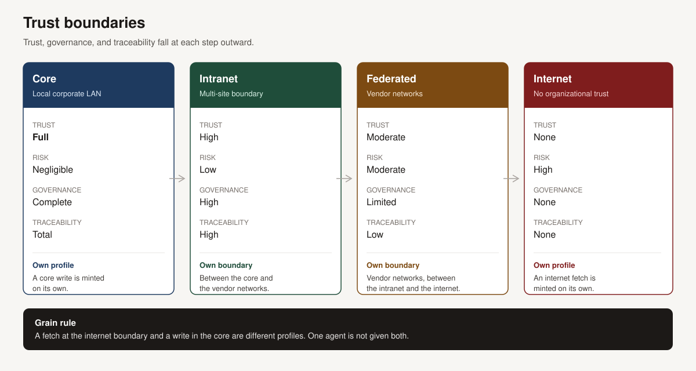

# **Scope & History-Aware Agentic Security (SHAS): A Distributed Security Framework**

## **Abstract**

Scope & History-Aware Agentic Security (SHAS) is a distributed architecture that acts as a wrapper around the existing SPIFFE/SPIRE identity framework. While SPIRE effectively answers which workload is calling and which node it runs on, it does not account for shifts in context, leaving agentic systems vulnerable to prompt-injection threats. SHAS addresses these vulnerabilities by embedding an agent’s scope, historical reputation, and intended credentials directly into the security architecture. By enforcing strict profile validations, deterministic policy blocks, and post-execution memory sanitization, SHAS mitigates four primary classes of context attacks: direct prompt injection, indirect prompt injection across trust boundaries, context hacking of shared memory, and temporal attacks that reuse memory or authority after expiration.

![Consolidated flow. The request passes the guardrails, is planned from discovery memory, and revised by Asago. The dispatcher cuts the profile at a trust boundary, Cedar permits publication, and the check value rides the Bellman countdown into the SPIRE token gate. The gateway and Progent gate the call. A cold start or an anomalous call stays in the sandbox until reconcile. The Recorder admits the next brief, quarantines a dangerous chain, wipes the agent, and keeps a same-fault bonded report for forensics.](../figures/shas-flow.svg)

## **1\. The Distributed Threat Landscape**

Agentic workloads fundamentally shift the security paradigm because they are non-deterministic and often required to traverse multiple security boundaries to complete a task. A routine request from a senior leader for a supply chain report may force an internal agent to gather information from highly secure internal sources, followed by queries to remote vendor sites in foreign networks.

This traversal spans several trust boundaries:

| Trust Boundaries | Trust Level | Risk Level | Governance | Traceability/Observability |
| :---- | :---- | :---- | :---- | :---- |
| Core (local corporate LAN) | Full  | Negligible  | Complete  | Total  |
| Intranet (multi-site security boundary) | High  | Low  | High  | High  |
| Federated network (Vendor networks) | Moderate  | Moderate  | Limited  | Low  |
| Internet | None  | High  | None  | None  |

When an agent accesses external sites to fulfill a query, it is exposed to the local threat landscape. Without proper containment, an agent could ingest a prompt injection, bring it back across boundaries into the Core network, and poison the swarm’s shared context or memory graph. SHAS treats such boundary crossings as dual-exposure vectors and limits the blast radius of compromised agents by ensuring that even poisoned agents can only execute their strictly assigned, historically validated tasks.

## **2\. Core Architecture & Minting**

To prevent poisoned memory propagation, agents in the SHAS framework are strictly minted for their tasks, and the multi-turn swarm memory is maintained as a highly monitored series of briefs rather than an open communication channel.

### **2.1 Orchestration, Planning, and Discovery**

* **The Discovery Protocol:** Before planning, the Dispatcher creates short-lived, hardcoded, read-only agents (e.g., using Ansible) to poll known network resources for available data based on the current role.

* **Separated Discovery Memory:** The resulting Completed Work Order Reports (CWORs) are stored in a distinct memory space completely separate from workload memory, providing the Orchestrator and Dispatcher with untainted topological context.

* **Policy-as-Code Revision:** The Orchestrator develops a granular plan and runs it against a policy-as-code engine (such as Asago).

* **Iterative Auditing:** The plan is iteratively revised until it passes the policy audit or reaches an administrator-defined turn limit.

* **Input and Output Guardrails:** The initial user prompt passes input guardrails before agent assignment, and the Orchestrator's plan passes output guardrails before the Dispatcher assigns it, ensuring that a request attempting to leave the assigned duty fails immediately.

### **2.2 Minting and Policy Publication**

* **The Grain Rule & Security Boundaries:** The Dispatcher prefers utilizing multiple existing single-job agents over minting a single agent capable of spanning multiple trust boundaries.

* **External Policy Evaluation:** Publication of a newly minted profile is governed by an external authorization engine (such as Cedar).

* **Boundary Enforcement:** A profile whose actions attempt to span two distinct trust boundaries (e.g., core writes and internet fetches) receives no permit and is never published.

* **Immutable System Prompts:** Once minted, the agent's system prompt and creation metadata generate a public check value.

* **Check Value Binding:** The check value strictly binds the system prompt, meaning any direct injection attempt that replaces the formulation will fail the integrity check.

* **Best-Guess Addendum:** A "best-guess" workflow is attached strictly to the first user prompt of a newly minted agent, purposefully excluded from the system prompt so it cannot alter the published check value.

### **2.3 The Encrypted Bellman Protocol & Temporal Security**

* **Cryptographic Broadcasts:** The Bellman Protocol is a cryptographically signed broadcast that informs edge nodes of valid, commissioning, and decommissioning agents.

* **Volatile Revocations:** Because revocations are volatile, they trigger an immediate Bellman publication rather than waiting for a scheduled poll.

* **Decommissioning Countdowns:** The broadcast carries a decommission countdown for unused agents, which can be reset by subsequent lists.

* **Token Issuance Gates:** SPIRE will only issue a token if the remaining countdown outlasts the token's lifetime and a resetting publication occurs before the countdown expires.

## **3\. The Execution Pipeline & Zero Trust Containment**

SHAS enforces zero trust principles by placing enforcement points directly on the request path, ensuring anomalous or unauthorized behavior never reaches the primary database.

### **3.1 The Attestation Gateway**

When an agent reaches a resource gateway, the system hashes the presented system prompt to validate the check value against the local Bellman registry. The gateway integrates with SPIFFE/SPIRE to answer five gating questions:

1. Is this one of the organization’s approved agents?

2. Where did this agent come from?

3. When is the work supposed to be done?

4. What is this agent allowed to do and request from this resource based on its profile?

5. Who is this agent working on behalf of?

### **3.2 Reputation, Monitoring, and the Sandbox**

* **Agent Reputation Database (ARDB):** The ARDB tracks recent behavior of agents on local nodes (retained from hours to weeks) to establish a baseline of expected work.

* **Fingerprinting Cold Starts:** Every cold-start agent must run its first task in the Task Sandbox to establish its initial fingerprint and base run for the ARDB.

* **Policy Enforcement Points (Progent):** Tool calls are deterministically evaluated against published policy before execution; calls forbidden by policy (e.g., bulk deletions outside the permitted scope) are blocked entirely.

* **Sandboxing Anomalies:** Permitted calls that are anomalous (outside the established baseline) are transferred to the Task Sandbox by the Agent Monitoring Client.

* **CRDT Shards and Dry Runs:** Inside the sandbox, writes and deletes are recorded as local CRDT shards. A dry run verifies these shards to ensure the effects are not destructive or breaking.

* **Effect Reconciliation (in-toto Layouts):** Shards are only reconciled into the primary database once the agent's profile is validated and the dry run proves the effects match the allowed layout. Untrusted data retrieved by the agent (e.g., via CaMeL control flow protections) cannot choose or force these effects.

### **3.3 Helper Reuse and Subcontracting**

* **Subset Relations (Zanzibar):** Helpers carry stricter limits than primary agents and are requested from the Dispatcher.

* **Equal or Reduced Scope:** A later task may only reuse a remembered helper if the scope of the new task is equal to or reduced compared to the helper's minted profile.

## **4\. Post-Execution, Memory, and Forensics**

The architecture strictly regulates how a completed task becomes context for future tasks to prevent poisoned memory propagation.

### **4.1 The Recorder and Drift Validation**

* **Report Generation:** After execution, the agent returns a structured JSON Completed Work Order Report (CWOR) detailing retrieved information, tools called, queries made, and resources accessed.

* **Drift and Adherence:** The Recorder compares the report against organizational policy and the system prompt. The drift result checks for adherence; a factual error inside the assigned duty passes, but exfiltrating data outside the system prompt fails adherence and is withheld.

* **Sanitization:** The Recorder sanitizes restricted information and runs the CWOR through guardrails aimed at direct injections.

### **4.2 Semantic Auditing and Quarantine**

* **Session Audits (JEV Models):** CWORs in a multi-turn workflow carry session tags, allowing a classifier (like a JEV model) to semantically audit the entire chain before adding it sequentially to memory.

* **Quarantine:** A session chain read as dangerous is instantly stopped, isolated, quarantined, and flagged for human review. Quarantined reports are never used as the next brief.

* **Context Wiping:** Once a report is submitted, the specific agent's context, tool calling, tool cache, memory, and indices are completely wiped before returning to the warm pool.

### **4.3 Redos and Bonded Agents**

* **Workload Redos:** If a CWOR is rejected, the Recorder prompts the Dispatcher to reattempt the task with a different, tighter minted agent.

* **Bonded Agents:** To work around failed CWORs, the Dispatcher utilizes one-shot Bonded Agents.

* **Synchronous Hashing:** The entire bonded prompt is hashed and published synchronously via the Bellman Protocol exclusively to the nodes involved in the previous failure.

* **Read-Only Forensics:** Bonded agents are strictly read-only and disappear immediately after their sub-task is completed.

* **Avoidance Routing:** If a bonded agent's report reveals the same fault, it is retained for forensics but never added to memory. The Orchestrator is instructed to avoid the source, and if the workflow cannot proceed without it, the task fails cleanly.

## **Conclusion**

Scope & History-Aware Agentic Security ensures that no single agent possesses the ability to execute an entire cybersecurity kill chain. By building on top of SPIFFE/SPIRE—which effectively authenticates *who* the agent is and *where* it operates—SHAS systematically authenticates *how* the agent is formulated, *what* its exact profile permits, *which* context it is allowed to retain, and *when* it is authorized to act. Through cryptographic prompt integrity, zero-trust sandbox containment, and aggressive memory sanitization, SHAS transforms distributed agentic workloads from systemic risks into reliable, scope-bound components.  
